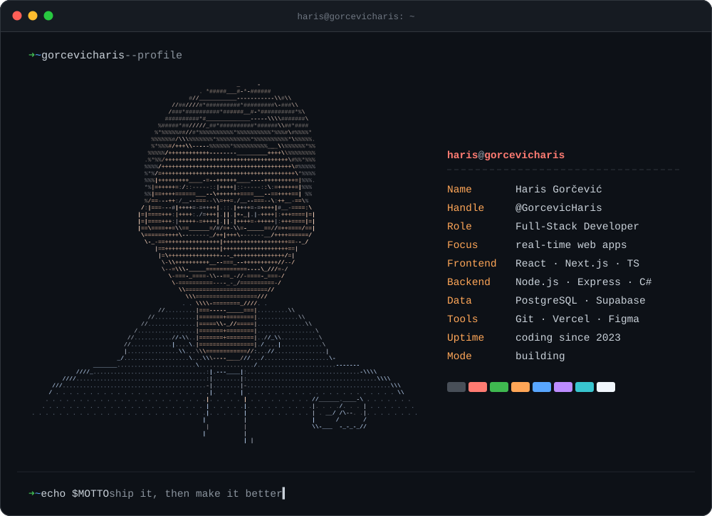
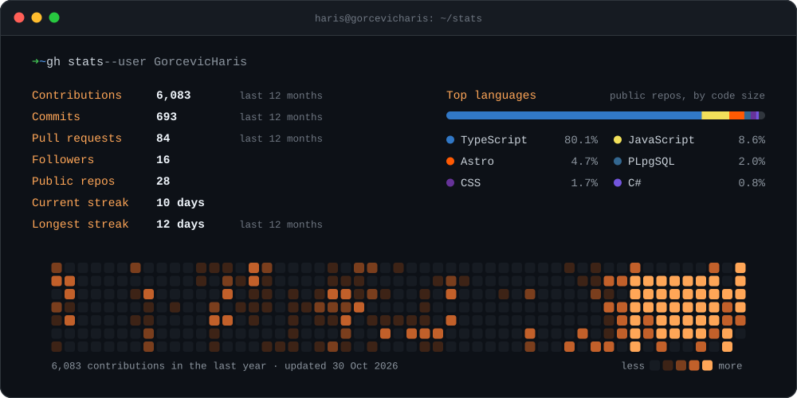
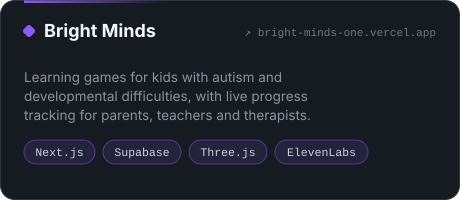
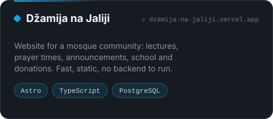
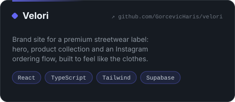
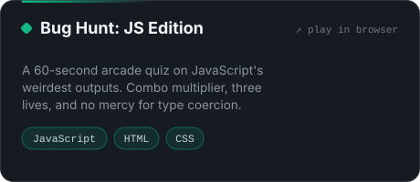

<!-- Haris Gorčević · github.com/GorcevicHaris -->

  

 

## About Me

I'm **Haris**, a full-stack developer who builds web apps people actually enjoy using: fast interfaces, clean architecture, and real-time features that feel instant.

I work across the whole stack, from **React / Next.js** front ends to **Node.js** and **C#** back ends on **PostgreSQL**. I care most about the details users feel and never see: a snappy UI, a schema that still makes sense at feature #47, and code the next person can read.

- 🔭 Building production apps with **React, Next.js and TypeScript**
- ⚡ Happiest with **real-time** work: sockets, live data, instant feedback
- 🌱 Going deeper into **PostgreSQL design** and advanced **TypeScript**
- 🤝 Open to freelance work and collaborations

 

## Tech Stack

<table>
  <tr>
    <td width="150"><b>FRONTEND</b></td>
    <td></td>
  </tr>
  <tr>
    <td><b>BACKEND &amp; DATA</b></td>
    <td></td>
  </tr>
  <tr>
    <td><b>TOOLS</b></td>
    <td></td>
  </tr>
</table>

 

## GitHub Statistics

  
  Redrawn every day by a GitHub Action, no third-party stats service.

 

## Featured Projects

<table>
  <tr>
    <td width="50%">
      
      
<a href="https://bright-minds-one.vercel.app">Live</a> · <a href="https://github.com/GorcevicHaris/BrightMinds">Code</a>

    </td>
    <td width="50%">
      
      
<a href="https://dzamija-na-jaliji.vercel.app">Live</a> · <a href="https://github.com/GorcevicHaris/mosqueJalija">Code</a>

    </td>
  </tr>
  <tr>
    <td width="50%">
      
      
<a href="https://github.com/GorcevicHaris/velori">Code</a>

    </td>
    <td width="50%">
      
      
<a href="https://gorcevicharis.github.io/dev-arcade/">Play</a> · <a href="https://github.com/GorcevicHaris/dev-arcade">Code</a>

    </td>
  </tr>
</table>

 

## Contact

Have an idea, a project, or a problem that needs solving? I'm one message away.

  
  
  
  

 

  <code>➜ ~ echo $MOTTO</code> &nbsp;ship it, then make it better

